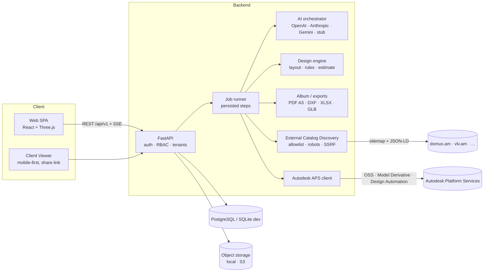

# Архитектура



## Решения (подробно — `DECISIONS/`)

| Область | MVP-решение | Почему |
|---|---|---|
| Backend | Python 3.12 + FastAPI, SQLAlchemy 2 | геометрия, CV, PDF/DXF (ReportLab, ezdxf, Shapely) — сильная экосистема Python (ADR-001) |
| Web | React 18 + Vite + TypeScript, Three.js | лёгкий SPA; Next.js не нужен для приложения за логином; лендинг можно вынести позже (ADR-002) |
| БД | PostgreSQL (Compose), SQLite для dev/тестов | одна модель, `create_all` в dev, Alembic для prod (ADR-003) |
| Очередь | Персистентные задачи + ThreadPool | шаги и прогресс в БД, SSE; интерфейс `enqueue/submit` совпадает с Redis/BullMQ/Celery (ADR-004) |
| Сцена | Собственный JSON BuildingGraph в мм | связывает чертежи, 3D, правила и смету; конвертеры в DXF/GLB/IFC (ADR-005) |
| AI | Абстракция провайдеров + stub | нет vendor lock-in; честный dev-режим без ключей (ADR-006) |
| Каталог | PIM + снимок внешнего каталога проекта | внешние данные не загрязняют основной каталог (ADR-007) |
| CAD | DXF своими силами, DWG — только через Autodesk APS Design Automation | без сомнительных конвертеров DWG (ADR-008) |

## Модули API

```
app/
  scene/       model.py (BuildingGraph) · geometry.py · rules.py · layout.py · recognize.py · svg.py · demo.py
  ai/          providers.py · orchestrator.py · schemas.py · stub.py · prompts/*.v1.md
  catalog/     taxonomy · candidates (единый Candidate) · discovery · normalize · net (SafeFetcher) · connectors/*
  design/      engine.py (варианты) · changes.py (AI-команды → операции)
  estimate/    estimator.py
  album/       draw.py · sheets.py · render3d.py · i18n.py · builder.py
  exports/     files.py (DXF, XLSX, CSV, GLB)
  aps/         client.py
  jobs/        runner.py · pipeline.py · recognize.py · documents.py
  routers/     auth · projects · commerce · documents · catalog · admin · partners
```

## Поток данных «изменил диван → всё пересчиталось»

1. Команда/ручная правка → `design/changes.py` или `PUT /objects`.
2. Новая неизменяемая `DesignVersion` (сцена + selection + diff).
3. `services.recompute`: правила (`scene/rules.py`) + детерминированная смета.
4. Альбом/DXF/GLB/XLSX строятся из этой версии — один источник истины.

## Масштабирование (после MVP)

* Очередь: заменить ThreadPool на Redis + RQ/Celery/Temporal; интерфейс `jobs.runner.enqueue` не меняется.
* Хранилище: S3-драйвер с теми же методами `put/get/signed_url`.
* Поиск: pgvector/OpenSearch для семантического подбора; сейчас — фильтры + скоринг.
* Рендер: провайдер изображений (GPT Image/Flux) или Blender/Cycles worker — получает **только** выбранные SKU.
