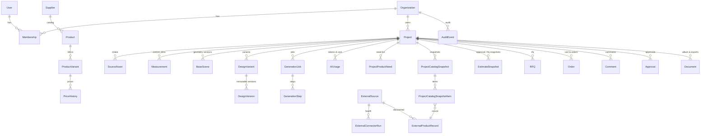

# ERD (реализовано в `apps/api/app/models.py`)

Геометрия хранится версиями JSON-сцены (BuildingGraph), всё коммерческое — реляционно.

## Соответствие сущностям ТЗ

| ТЗ | Реализация |
|---|---|
| Floor, Room, Wall, Opening, Scene, SceneObject, GeometryAssumption | `scene/model.py` (Pydantic) внутри `BaseScene.data` / `DesignVersion.scene` |
| ValidationIssue | `DesignVersion.issues` (результат rules engine) |
| DesignBrief | `Project.brief` (валидируется `ai/schemas.DesignBrief`) |
| Specification / Estimate / EstimateSection / EstimateLine | `DesignVersion.estimate` (детерминированный JSON) + `EstimateSnapshot` |
| ProductPlacement | `SceneObject.product_variant_id` (`pv:` внутренний SKU / `ext:` внешняя запись / `concept:`) |
| Alternative | ранжированные списки в `DesignVersion.change_summary.selection` |
| CustomProductDefinition / ProductConfiguration | `Product.parametric` + `SceneObject.custom_product` (длина, модули, made_to_measure) |
| Delivery / Installation / Commission | `Supplier.delivery/installation/commission_pct`, `Order.totals` |
| Notification, Payout, Session/Identity | следующая итерация (токены — stateless; см. SECURITY) |

Идентификаторы — UUID4 hex; уникальные ограничения tenant-aware (`ExternalProductRecord(source_id, external_key)`,
`DesignVersion(variant_id, number)`, `ProductVariant(product_id, sku)`).
